# insanemembrane

Replacement keyboard membranes for the **Commodore Amiga 1200, 500 and 600**, made as 2-layer polyimide flex PCBs
to be ordered from JLCPCB.

The originals are Mitsumi carbon-and-silver-ink membranes, and after 30+ years they crack and their traces break.
Each replacement is a **1:1 copy of the original**:
- the outline, holes, key pads and contacts are measured from 600 dpi scans of a real membrane;
- the matrix wiring is traced from the original's own silver traces and printed crossover bridges;
- the traces become gold-plated copper, with every trace and bridge at exactly 0°, 45° or 90°.

| | A1200 | A500 | A600 (green) |
|---|---|---|---|
| Original | Mitsumi 56C774A | Mitsumi A-500(E) 56 A619B | Mitsumi A300-B 30M 56C471B |
| Keys | 96 + Caps Lock LED | 96 + Caps Lock LED | 78 + Caps Lock LED |
| Connector | 31-pin tail, 1.25 mm | 31-finger tab, 1.25 mm | 30-pin tail, 1.25 mm |
| Board size | 237.0 × 440.0 mm | 134.5 × 441.1 mm | 249.8 × 316.9 mm |
| Status | rev A, fit check passed, ordered | rev A, fit check passed | rev A, fit check passed |
| Folder | [`a1200/`](a1200/) | [`a500/`](a500/) | [`a600/`](a600/) |

**Planned:** the **blue A600 membrane**, the other A600 version, will follow once an original is available to scan.

---

## Amiga 1200 — Mitsumi 56C774A

<table><tr>
<td width="38%">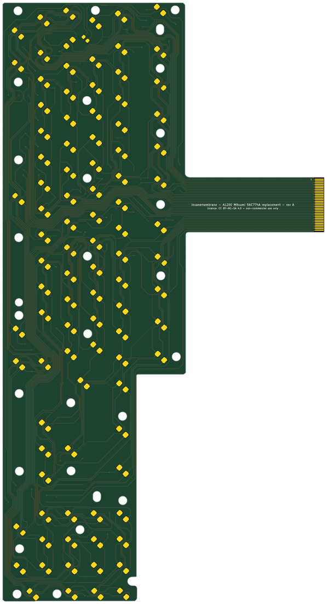</td>
<td>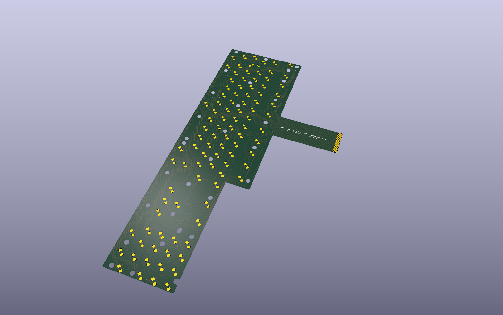<br><br>
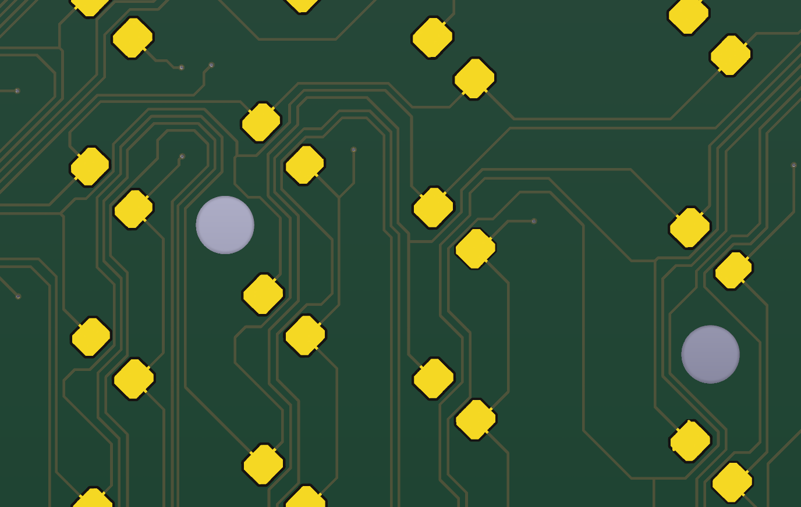</td>
</tr></table>

The 31-pin tail plugs into CN13 on the A1200 motherboard. It is 10 mm shorter than the original, because the original
has spare length and bows when plugged in. A 0.10 mm PI stiffener behind the contacts brings them to 0.21 mm total, like
the original. The tail traces enter the contacts by a hand-routed method: each trace's 45° diagonal runs on to its
contact's height, then one straight line goes in.

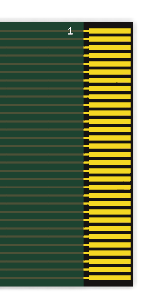

## Amiga 500 — Mitsumi A-500(E) 56 A619B

<table><tr>
<td width="30%">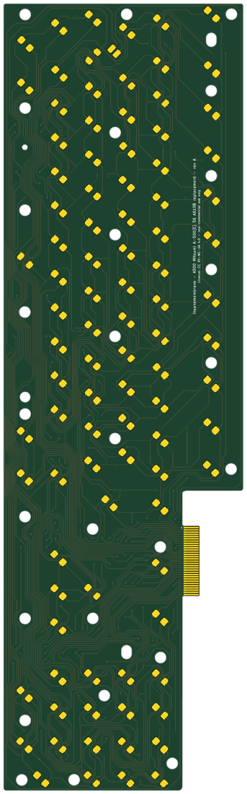</td>
<td>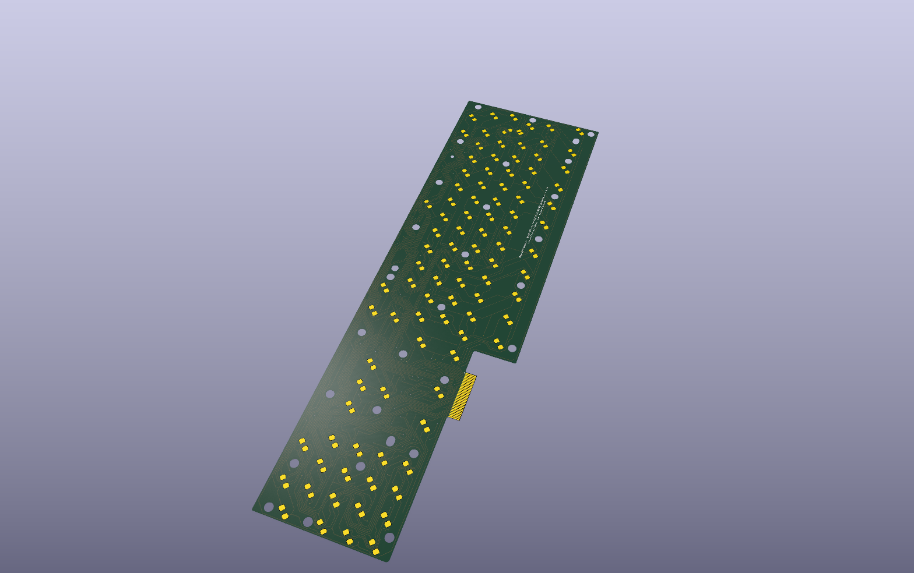<br><br>
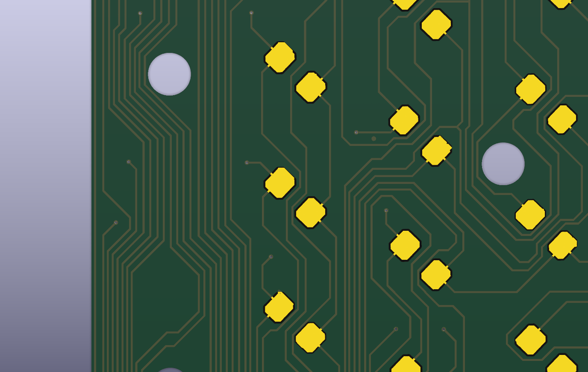</td>
</tr></table>

The A500 has no tail. Its 31 gold fingers sit on a short tab at the step in the outline and plug into the FFC connector
on the keyboard's controller board. A PI stiffener behind the fingers (7.86 mm, as on the original) brings them to about
0.40 mm. The outer corners are rounded to R 1.2 mm to match the original.

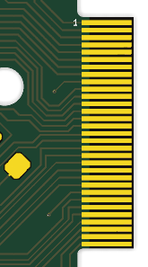

## Amiga 600 (green) — Mitsumi A300-B 30M 56C471B

<table><tr>
<td width="45%">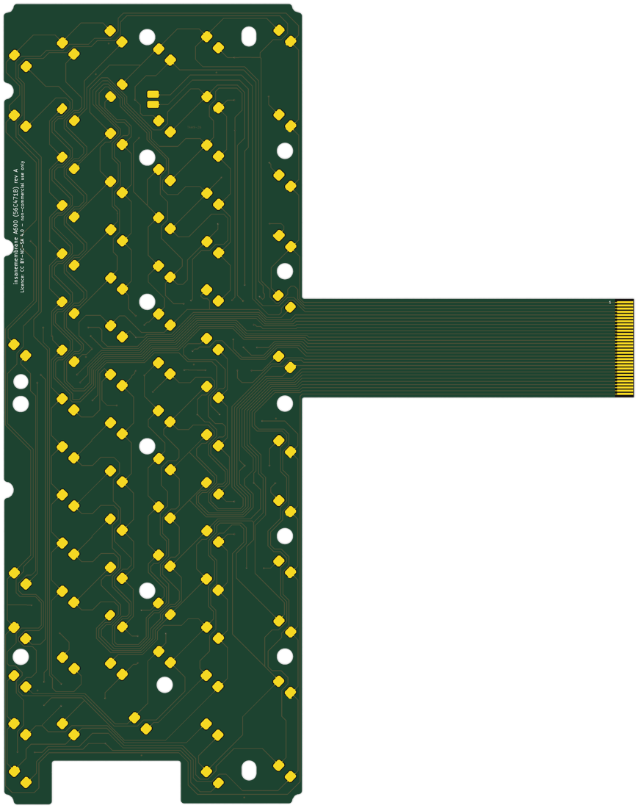</td>
<td>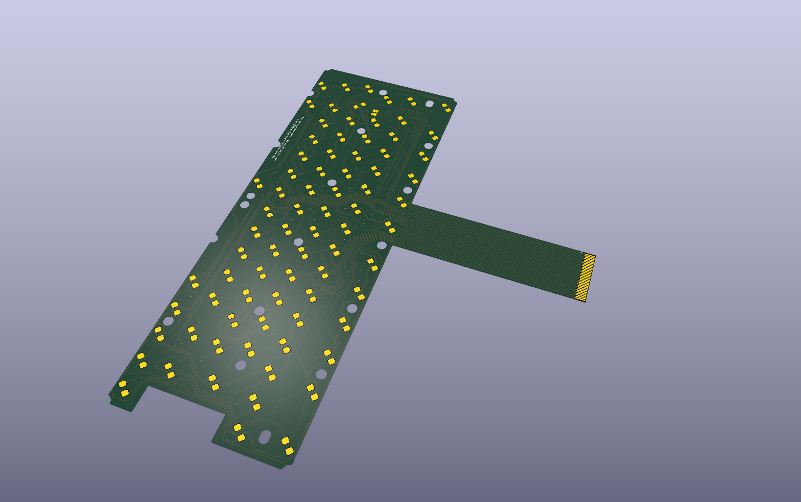<br><br>
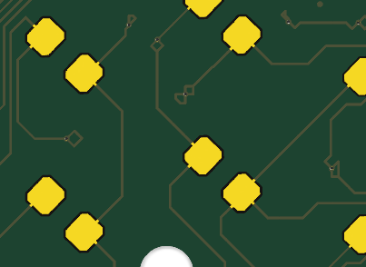</td>
</tr></table>

The original's tail is 180 mm long. Here it is shortened to 131.7 mm so the board stays inside JLC's 250 mm flex limit.
A 100 mm PI stiffener sits behind the 30 contacts. The original's notched corners and half-round edge notches are
copied from the scan.

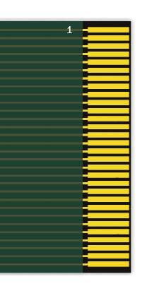

---

## Ordering

Each membrane's `fab/` folder is a ready JLCPCB flex order:
- the Gerber + drill zip,
- `JLC-ORDER.md`, with the order-form settings and a remark short enough for JLC's notes field,
- a **1:1 fit-check PDF**: print it at 100 % and lay your original membrane on top to check the outline, holes and pads.

[`a1200/fab/ORDER-SETTINGS.md`](a1200/fab/ORDER-SETTINGS.md) compares the settings for all three side by side. The same
file is also in `a500/fab/` and `a600/fab/`.

In short, all three are:
- 2-layer flex, 0.11 mm,
- 0.5 oz copper,
- ENIG 2 µ",
- PI coverlay,
- with a PI stiffener on the bottom behind the contacts.

## How the boards are made

1. **Scan.** Each side of the membrane is scanned at 600 dpi on A4, in two halves, with printed rulers in view. The halves
   are lined up on the through-holes (to within ~0.04 mm) and stitched. The back side is mirrored onto the front.
2. **Measure.** Outline, holes, carbon key pads, the LED pads and the contacts are taken from the stitched scans. The
   skew and the scanner's Y scale are corrected.
3. **Trace the netlist.** The silver traces from the back scan are joined by the printed crossover bridges and by the
   carbon pads. Every key must end up on exactly two different connector pins, with no shorts. The A1200 is also checked
   against the skielek/A1200KB matrix.
4. **Route.** The silver traces become top copper and the bridges become bottom copper with tented vias. Every piece is
   then refitted to 0°/45°/90°, keeping ≥ 0.25 mm clearance and moving no more than 0.45 mm from the original.
5. **Build and check.** KiCad builds the board and runs DRC (all three: 0 violations, 0 unconnected). The script then
   exports the Gerbers, the drill files and the fit-check PDF.

## Repository layout

```
a1200/  a500/  a600/        one folder per membrane
  docs/                     design spec (with "as built"), working notes, stitched scans
  docs/scan-data/           measurements, netlist, routing, board geometry (JSON)
  kicad/                    KiCad 10 project
  fab/                      JLC order package + fit-check PDF + renders
tools/a1200|a500|a600/      per-model steps (make.sh, scan registration, geometry, replica routing)
tools/build/                shared stages: pads, heal, octi (0/45/90), tidy, build_board, check_print
tools/scan/                 generic scan helpers (holes, features, pad shape)
docs/                       project-wide: backlog, README images
```

The raw TIFF scans (≈100 MB each) are not in the repository.

## Rebuilding

You need KiCad 10 and a Python 3 venv in `.venv` with `numpy opencv-contrib-python-headless scipy shapely pillow`.
With the raw scans in the project root, rebuild a membrane with its own script:

```sh
tools/a1200/make.sh
tools/a500/make.sh
tools/a600/make.sh
```

Each script runs the whole chain from the scans through to the fab package.

## Licence

This project is licensed under [CC BY-NC-SA 4.0](LICENSE): you may build it for yourself, share it and adapt it with
credit, but not for commercial use, and adaptations must use the same licence. The A1200 key-matrix data comes from
[skielek/A1200KB](https://github.com/skielek/A1200KB) under the MIT licence; see [NOTICE](NOTICE).

**Not to be manufactured or sold by amikit or retropassion**, in any form, including anything made from or derived
from this design.
